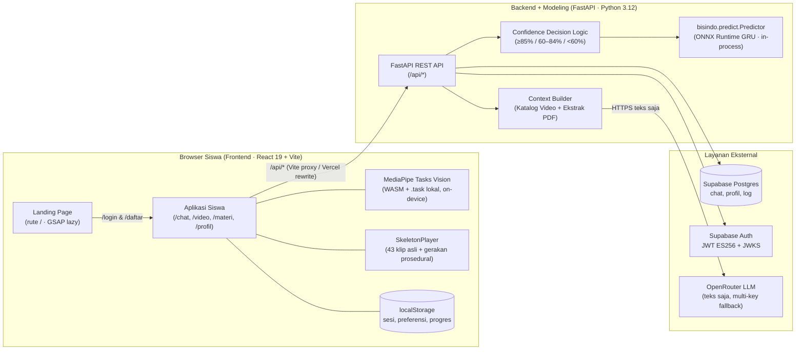
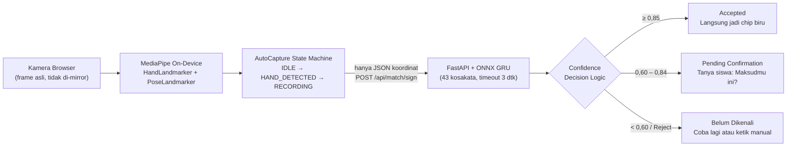

<div align="center">


# LUNAR — Teman Belajar Inklusif untuk Siswa Tuli

**Supaya siswa Tuli bisa bertanya dengan bahasanya sendiri, dan benar-benar mengerti.**

[](https://react.dev/)
[](https://vite.dev/)
[](https://www.typescriptlang.org/)
[](https://tailwindcss.com/)
[](https://developers.google.com/mediapipe)
[](https://vercel.com/)

*Repositori Frontend (Landing Page + Aplikasi Siswa) untuk ekosistem **LUNAR** (SEVENT X 2026).*  
*Backend & Modeling tersedia di repo terpisah: `Sesvents-Backend-Model`.*

</div>

---

## Mengapa LUNAR Dibuat?

Bagi banyak siswa Tuli, bahasa pertama mereka adalah **bahasa isyarat (BISINDO)**, sementara buku paket dan penjelasan di kelas disampaikan dalam **bahasa Indonesia baku** — terasa seperti belajar dalam bahasa kedua. Guru pun tidak selalu bisa mendampingi setiap siswa satu per satu, sehingga kesenjangan belajar kerap memuncak pada transisi jenjang **SD menuju SMP**.

**LUNAR** hadir sebagai platform belajar *chat-first* yang dirancang khusus untuk siswa Tuli:
- Bertanya lewat **isyarat BISINDO** melalui kamera, **ketikan**, atau **unggahan PDF materi**.
- Mendapatkan jawaban dalam **bahasa Indonesia yang pendek, ramah anak**, bisa disederhanakan lagi, dan **diperagakan kembali sebagai animasi isyarat** dengan *caption* sorotan kata demi kata.
- Menonton **Konten Pembelajaran** dan langsung bertanya pada **detik video tertentu** saat merasa bingung.

> **Framing Resmi Produk:** *AI membantu mengenali sejumlah kosakata BISINDO yang telah divalidasi (43 kata terlatih) untuk kegiatan belajar.* LUNAR tidak mengklaim menerjemahkan seluruh kalimat bebas BISINDO — dan selalu jujur saat sistem kurang yakin.

---

## Fitur Utama

| Fitur | Ringkasan |
|---|---|
| **Tanya LUNAR (`/chat`)** | Beranda ramah siswa dengan maskot harimau & pertanyaan cepat. Jawaban hadir dalam teks sederhana + animasi isyarat (lengkap dengan seekbar & layar penuh), serta tombol **Salin**, **Sederhanakan**, dan **Caption**. |
| **Pakai Isyarat (Kamera On-Device)** | Mengenali **43 kosakata BISINDO** melalui MediaPipe di browser. Kata dengan keyakinan **≥ 85%** masuk sebagai chip biru, **60–84%** meminta konfirmasi jujur siswa (*"Maksudmu kata ini?"*), dan **< 60%** menolak secara jujur (*"Isyarat belum dikenali"*). |
| **Unggah PDF Materi** | Unggah materi PDF berbasis teks (≤ 5 MB, ≤ 10 halaman) sebagai konteks pertanyaan di dalam percakapan; byte PDF dibuang setelah ekstraksi teks. |
| **Konten Pembelajaran & Tanya per Detik (`/video`)** | Katalog materi kurikulum (`Konten LUNAR ✓` + pratinjau tab `Komunitas` *segera hadir*), detail materi + tombol **Rangkum materi ini**, pemutar video ber-bab dengan juru isyarat, *caption* sorotan kuning, serta chat samping yang otomatis menempelkan **detik video** saat bertanya. |
| **Materi Saya & Riwayat (`/materi`, `/riwayat`)** | Menyimpan materi terakhir ditonton, konten yang di-bookmark, daftar PDF terunggah, serta riwayat & pencarian judul percakapan. |
| **Profil & Aksesibilitas (`/profil`)** | Edit nama panggilan *inline*, ringkasan **Kegiatan Belajarku (7 hari terakhir)**, serta pengaturan **ukuran teks**, **ukuran caption (Kecil/Sedang/Besar)**, **kecepatan animasi isyarat (Pelan/Normal/Cepat)**, dan **putar otomatis**. |
| **Akun Mandiri (`/login`, `/daftar`)** | Masuk & daftar mandiri dengan **Email + No. Telp + Password**, lengkap dengan alur **Lupa Password** dan refresh sesi otomatis. |
| **Mode Kiosk Kelas (`/kiosk`)** | Rute khusus demo kelas dua arah (siswa ↔ guru di satu perangkat, tersembunyi dari menu utama). |

---

## Arsitektur Sistem Full-Stack

Frontend tidak pernah memanggil OpenRouter, Supabase, atau model ML secara langsung — seluruh orkestrasi, autentikasi, dan keputusan *confidence* berjalan aman melalui Backend FastAPI.



---

## Pipeline Inti

### 1. Pipeline Pengenalan Isyarat (*Privacy-First On-Device Vision*)

Wajah dan rekaman video kamera siswa **tidak pernah meninggalkan perangkat**. Browser hanya mengekstrak koordinat titik tangan & bahu lalu membuang buffer setelah hasil diterima.



### 2. Pipeline Tanya AI, Konteks Video/PDF & Animator Isyarat

```mermaid
flowchart LR
    Q["Pertanyaan Siswa<br/>(Ketik / Chip Isyarat)"] --> P["POST /api/chat/sessions/:id/messages<br/>+ referensi detik video / PDF"]
    P --> C["Backend Context Builder<br/>Transkrip bab video + teks PDF (≤12k char)"]
    C --> LLM["OpenRouter LLM<br/>System Prompt: singkat & ramah anak"]
    LLM --> CL["Sanitasi & Simpan DB<br/>(clean_reply ≤ 2000 char)"]
    CL --> UI["Kartu Jawaban FE<br/>Teks + Salin / Sederhanakan"]
    UI --> TOK["textMatch.ts + sentence.ts<br/>Cocokkan 43 klip asli + prosedural"]
    TOK --> ANIM["SkeletonPlayer<br/>Animasi isyarat + caption sorotan kuning"]
```



---

## Tech Stack (Frontend)

| Kategori | Teknologi |
|---|---|
| **Core** | React `19.3`, TypeScript `5.9`, Vite `8.3`, React Router `7.18` |
| **Styling & Tipografi** | Tailwind CSS `4.3` (`@tailwindcss/vite`), Lexend Variable (`@fontsource-variable/lexend`), `lucide-react` |
| **Animasi** | Framer Motion `13.4` (aplikasi siswa), GSAP `3.15` + `@gsap/react` (lazy khusus landing page) |
| **Computer Vision (On-Device)** | `@mediapipe/tasks-vision` `1.0.1` + model `.task` lokal (`hand_landmarker.task`, `pose_landmarker_lite.task`) |
| **Hosting** | Vercel (`vercel.json` SPA fallback + rewrite `/api/*`) |

---

## Rute Aplikasi

| Rute | Halaman | Akses |
|---|---|---|
| `/` | Landing page publik (`src/landing/`) | Publik |
| `/login` | Masuk siswa (Email + Password) & Lupa Password | Publik |
| `/daftar`, `/register` | Redirect ke `/login?mode=register` (Daftar Mandiri) | Publik |
| `/chat`, `/chat/:sessionId` | **Tanya LUNAR** (beranda + percakapan + Pakai Isyarat + Unggah PDF) | Siswa (Login) |
| `/video`, `/video/:id` | **Konten Pembelajaran** (daftar materi, tab Komunitas, tonton + tanya per detik) | Siswa (Login) |
| `/materi` | **Materi Saya** (terakhir ditonton, disimpan, daftar PDF) | Siswa (Login) |
| `/riwayat` | **Riwayat Percakapan** (cari, buka, ganti nama, hapus) | Siswa (Login) |
| `/profil` | **Profil & Aksesibilitas** (nama panggilan, aktivitas 7 hari, ukuran teks/caption/kecepatan) | Siswa (Login) |
| `/kiosk` | **Mode Kiosk Kelas** dua arah (tersembunyi dari menu) | Siswa (Login) |

---

## Struktur Folder

```text
Frontend/
├── public/                     # favicon.svg, logo.png, card-clouds.jpg, dev-samples/ (mediapipe/ auto-copied)
├── models/                     # Model MediaPipe .task lokal (sama dengan ml/mp_models di repo backend)
├── scripts/                    # copy-mediapipe.mjs (predev/prebuild), sync-vocabulary.mjs, sync-skeletons.mjs
├── src/
│   ├── auth/                   # AuthContext, auth.service.ts, token.ts, LoginPage, ForgotPasswordDialog
│   ├── components/             # UI primitif, TigerMascot, MateriVisuals, komponen kiosk, ErrorBoundary
│   ├── config/                 # app.config.ts, capture.config.ts, confidence.config.ts
│   ├── data/                   # materi.ts (katalog video), vocabulary.ts (43 kata), phrases.mock.ts
│   ├── features/
│   │   ├── chatbot/            # ChatParts, SignCapture, AnswerSign, chat.service.ts, useChat
│   │   ├── sign-to-text/       # autoCapture.ts, useHandTracking.ts, landmarkFrame.ts, SignPanel
│   │   ├── skeleton-animation/ # SkeletonPlayer, skeleton.config.ts, processSkeleton.ts, data/label_00..42.json
│   │   └── speech-to-sign/     # Alur guru di mode kiosk (STT → animasi)
│   ├── landing/                # Landing page modular (Hero, FeatureStrip, Why, Chatbot, HowItWorks, Confidence, ForEveryone)
│   ├── layout/                 # AppShell (sidebar desktop, bottom nav mobile, pencarian chat)
│   ├── pages/                  # ChatPage, VideoListPage, VideoWatchPage, MateriSayaPage, HistoryPage, ProfilePage
│   ├── services/               # matching.service.ts, textMatch.ts, logs.service.ts
│   └── state/                  # SettingsContext, materi.store.ts, nickname.store.ts, KioskContext
├── PRD.md                      # Kebutuhan produk, framing wajib, dan roadmap
├── ARCHITECTURE.md             # Arsitektur runtime, struktur repo, state klien, dan operasional
├── SYSTEM_DESIGN.md            # Kontrak REST API, skema DB, prompt AI, dan state machine auto-capture
└── decisions.md                # Arsip ADR (Architecture Decision Records, append-only)
```

---

## Menjalankan Secara Lokal

### Prasyarat
- **Node.js 20+** dan `npm`
- **Backend LUNAR** berjalan di `http://127.0.0.1:8000` (lihat repo `Sesvents-Backend-Model`)

### Langkah Setup
```bash
# 1. Install dependensi
npm install

# 2. Salin konfigurasi environment lokal
cp .env.example .env

# 3. Jalankan dev server (otomatis menyalin aset WASM & model MediaPipe)
npm run dev
# Buka http://localhost:5174
```

> Untuk uji kamera/mikrofon dari HP di jaringan Wi-Fi yang sama, jalankan `npm run dev:https` lalu akses `https://<IP-laptop>:5174`.

### Variabel Lingkungan (`.env`)

| Variabel | Fungsi |
|---|---|
| `VITE_API_BASE_URL` | `/` (pakai Vite proxy di dev atau rewrite Vercel di prod) atau URL penuh Backend |
| `VITE_DEVICE_ID` | UUID baris `devices` di database untuk endpoint `/api/match/sign` |
| `VITE_AUTH_MODE` | `api` (terhubung ke Backend asli) |
| `VITE_BACKEND_URL` | *(Dev)* Target proxy `/api`, default `http://127.0.0.1:8000` |
| `VITE_DEMO_EMAIL`, `VITE_DEMO_PASSWORD` | *(Opsional)* Kredensial akun siap pakai di halaman login; kosongkan untuk build publik |

> `.env` sudah masuk `.gitignore` — jangan pernah di-commit ke Git.

### Cek Sebelum Push
```bash
npm run typecheck
npm run build
```

---

## Deploy ke Vercel

1. Import repositori ini di **Vercel** (framework **Vite** terdeteksi otomatis, `vercel.json` sudah tersedia).
2. Pastikan URL tujuan rewrite `/api/*` di `vercel.json` mengarah ke domain Backend produksi.
3. Isi *Environment Variables* (`VITE_API_BASE_URL=/`, `VITE_DEVICE_ID`, `VITE_AUTH_MODE=api`).
4. Build command `npm run build` otomatis menjalankan `copy-mediapipe.mjs` sehingga aset WASM & model `.task` tersaji langsung dari domain sendiri tanpa CDN pihak ketiga.

---

## Peta Dokumentasi

| Dokumen | Isi |
|---|---|
| [PRD.md](PRD.md) | Latar belakang masalah, target pengguna, fitur MVP, framing produk, dan roadmap |
| [ARCHITECTURE.md](ARCHITECTURE.md) | Arsitektur full-stack, tech stack terkunci, struktur repo, rute FE, penyimpanan klien, dan operasional |
| [SYSTEM_DESIGN.md](SYSTEM_DESIGN.md) | Alur end-to-end, kontrak REST API, skema database, konstruksi prompt AI, dan state machine auto-capture |
| [decisions.md](decisions.md) | Catatan keputusan arsitektur (ADR, bersifat *append-only*) |
